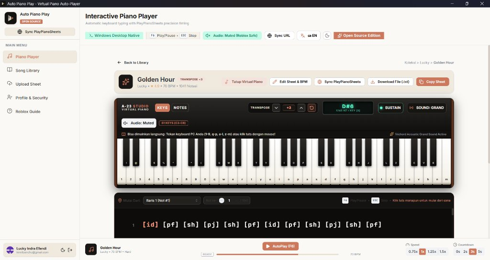
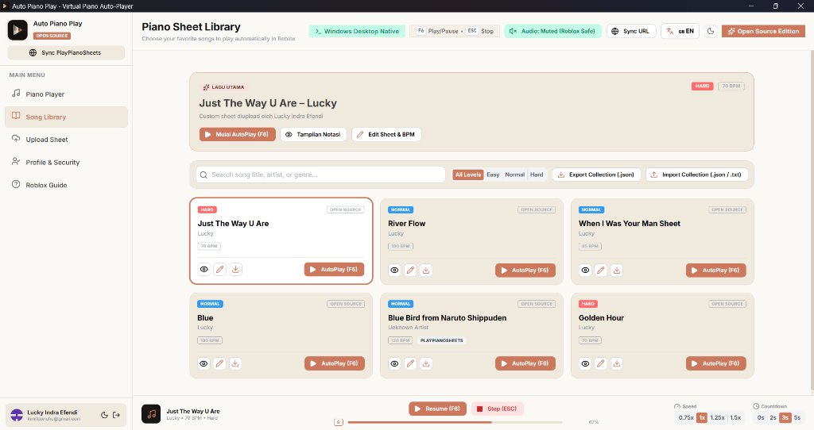

# AutoPiano — Virtual Piano Auto-Player (Open Source Edition)

An offline-first, native Windows desktop application built with **Tauri v2, Rust, React, TypeScript, and SQLite**. AutoPiano simulates realistic keyboard keystrokes for virtual piano games (such as Roblox virtual piano experiences) with high timing accuracy.

The software is **100% open-source**, free of charge, and operates completely offline with no cloud server dependencies. All user accounts, preferences, and custom music sheets are stored locally in a standalone SQLite database.

---

## Screenshots

| Interactive Piano Player & Studio Keyboard | Piano Sheet Library & Collection Manager |
| :---: | :---: |
|  |  |

---

## Key Features

- **Offline-First & Local Storage**:
  - All account credentials, user profiles, and musical sheets are stored locally in an embedded SQLite database (`autopiano.db`).
  - **Unlimited Sheets**: Create, import, and manage your sheet library without restrictions or quotas.
  - Zero subscriptions, paywalls, or external cloud accounts required.
- **Windows Native Keystroke Simulation (`SendInput`)**:
  - Uses native Windows hardware scan codes for keystroke delivery, ensuring direct detection by Roblox and desktop games.
- **Global Background Hotkeys**:
  - `F6`: Start playback / Pause / Resume directly while in the game window (no Alt-Tab required).
  - `ESC`: Instant emergency stop.
- **Interactive Sheet Viewer**:
  - Real-time token and chord highlighting (active note pill, completed notes, and upcoming keys).
  - High-readability monospaced layout using JetBrains Mono typography.
- **Playback & Timing Controls**:
  - Pause and resume playback from the exact note position.
  - Custom starting position: start from any line, note index, or click any note token directly.
  - Adjustable playback speed (0.75x to 1.5x) and customizable countdown timer.
- **Audio Clashing Protection**:
  - In-app synthesizer audio is muted by default to eliminate sound echo and clashing with in-game piano sounds.
- **On-Demand Sheet Sync**:
  - Import single songs via web link on demand for personal practice, with original source attribution.
- **Community Sheet Exchange**:
  - **Export Sheet (.txt)**: Download single musical notation files ready for sharing.
  - **Export Collection (.json)**: Backup your entire custom library to a structured JSON file.
  - **Flexible Import**: Import individual `.txt` notations or bulk-import multiple songs from `.json` files.
- **Local Account & Security**:
  - Local registration and authentication using SHA-256 password hashing.
  - Optional Multi-Factor Authentication (MFA) via TOTP authenticator apps.
- **Internationalization (i18n)**:
  - Full interface support for **English (EN)** and **Indonesian (ID)** with instant switching in the top navigation bar.

---

## Download & Quick Start (No Installation Required)

If you simply want to run AutoPiano without cloning the repository or setting up development tools:

1. Go to the **[GitHub Releases](https://github.com/OpenProjectOrg/autoplaypiano/releases)** section of this repository.
2. Look for the latest release tag (e.g., `v0.1.0`).
3. Under the **Assets** list, download the pre-compiled Windows executable (`autopiano.exe` or the `.msi` setup installer).
4. Launch the application directly on Windows. No Node.js or Rust installation required!

---

## Building from Source (For Developers)

### System Requirements (Build Environment)

- **Operating System**: Windows 10 or Windows 11 (64-bit)
- **Node.js**: Version 18.0.0 or later
- **Package Manager**: npm (bundled with Node.js)
- **Rust Toolchain**: Stable channel (`rustc` and `cargo`), downloadable from [rustup.rs](https://rustup.rs/)
- **Build Tools**: Microsoft C++ Build Tools (required for compiling native Windows Tauri binaries)

### 1. Clone the Repository

Download the project source files to your local machine:

```powershell
git clone https://github.com/OpenProjectOrg/autoplaypiano.git
cd autoplaypiano
```

### 2. Install Frontend Dependencies

Install all required Node.js packages:

```powershell
npm install
```

### 3. Run in Desktop Development Mode (Recommended)

To compile the Rust backend and launch the native Windows desktop app with hot-reloading:

```powershell
npm run desktop
```

*Note: On first launch, Cargo will compile the dependencies and the SQLite driver. Subsequent launches will start much faster.*

### 4. Run in Web Preview Mode (UI Development)

For rapid frontend design and UI testing in your default browser:

```powershell
npm run dev
```

### 5. Build Standalone Production Executable

To generate an optimized release `.exe` / `.msi` installer:

```powershell
npm run build:desktop
```

The compiled binaries will be output to:
`src-tauri/target/release/`

---

## In-Game Setup Guide (Roblox)

Follow these steps to ensure keyboard inputs are registered accurately:

1. **Launch the Application**: Run AutoPiano in desktop mode (`npm run desktop`).
2. **Open Roblox**: Join your virtual piano game of choice and seat your avatar at the piano.
3. **Verify Keyboard Settings**:
   - **CapsLock**: Must be **OFF** (when active, normal keys are triggered as sharps).
   - **ShiftLock Switch**: Set to **OFF** in the Roblox in-game settings.
   - **Chatbox**: Ensure the chat window is closed (press `/` then `ESC`).
4. **Focus the Game Window**: Click anywhere inside the Roblox window to give it active focus.
5. **Start AutoPlay**: Press **`F6`** on your keyboard to begin playback. Press **`F6`** again to pause/resume, or press **`ESC`** to stop immediately.

---

## Virtual Piano Notation Format

AutoPiano supports standard virtual piano text notation:

- **Single Notes**: Standard alphanumeric characters typed sequentially, separated by spaces (e.g. `a s d f`).
- **Chords**: Enclosed in square brackets to be pressed simultaneously (e.g. `[8w]`, `[9e]`).
- **Rhythm Pauses**: Whitespaces between notes determine timing delays according to the selected tempo (BPM).
- **Metadata Headers**: Optional comment lines starting with `//` or `#`:
  ```txt
  // Title: Song Title
  // Artist: Artist Name
  // BPM: 120
  // Difficulty: Normal
  
  [8w] y i p d y i p d
  ```

---

## Project Structure

```
autopiano-opensource/
├── src/                      # Frontend (React 19, TypeScript, Mantine UI)
│   ├── components/           # UI components (Player, Library, Uploader, etc.)
│   ├── i18n/                 # Localization dictionaries (en.ts, id.ts)
│   ├── lib/                  # Local storage, parser, synth, export utilities
│   ├── App.tsx               # Main application layout and state router
│   └── main.tsx              # Application entry point with providers
├── src-tauri/                # Backend (Rust, Tauri v2)
│   ├── src/
│   │   ├── db.rs             # SQLite schema, tables, and CRUD handlers
│   │   ├── keyboard.rs       # Windows SendInput keystroke synthesis
│   │   ├── parser.rs         # Note event parser and timing engine
│   │   └── lib.rs            # Tauri command router and hotkey listener
│   ├── Cargo.toml            # Rust dependencies (rusqlite, sha2, windows-sys)
│   └── tauri.conf.json       # Tauri application configuration
├── package.json              # Frontend scripts and dependencies
└── README.md                 # Project documentation
```

---

## Contributing

We welcome community contributions, bug reports, and feature suggestions! Please read our [Contributing Guidelines](CONTRIBUTING.md) and [Code of Conduct](.github/CODE_OF_CONDUCT.md) for details on code style, architectural rules, and the pull request process.

---

## License

This project is released under the **MIT License**. You are free to use, modify, and distribute this software for personal and community use.
